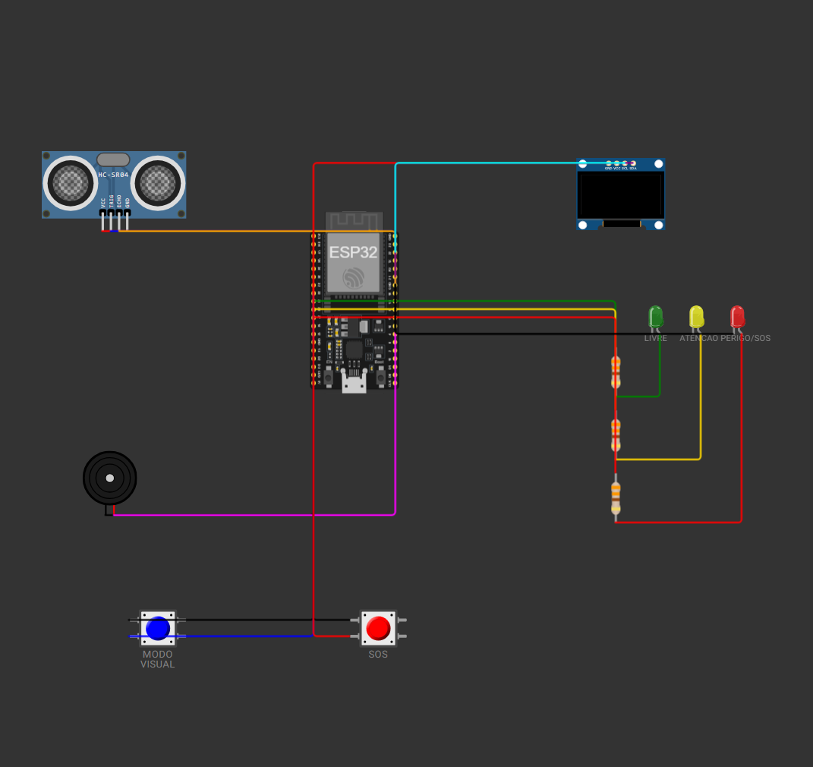
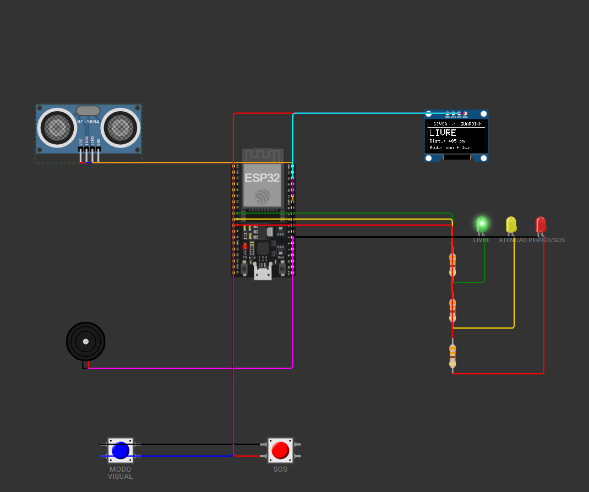
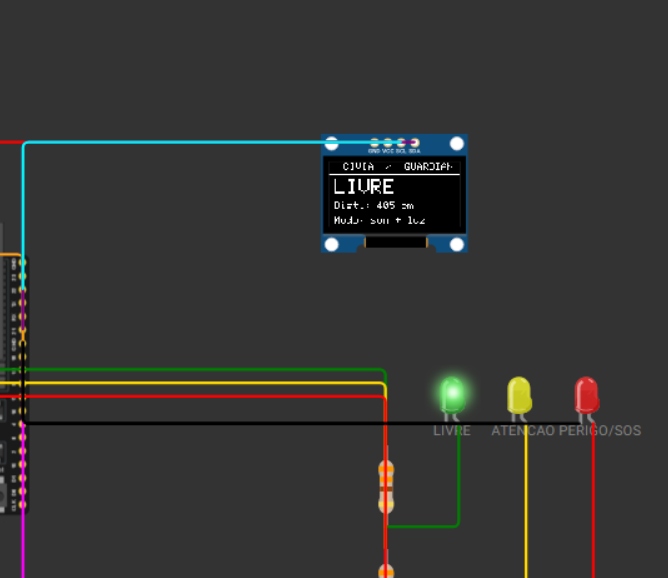
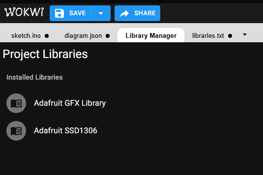

# CIVIA Guardian | ESP32 + Wokwi

**Global Solution 2026.2 — CitizenTech**  
**Disciplina:** Physical Computing: IoT & IoB  
**Turma:** 3ESPS — Engenharia de Software

> **Acessibilidade começa quando a informação chega a todos.**
>
> Protótipo de alerta sensorial que utiliza um ESP32 para interpretar a proximidade de objetos e representar avisos por **luz, som e texto**.

---

## Ficha do Projeto

| Item | Descrição |
|:--|:--|
| **Nome** | CIVIA — módulo **CIVIA Guardian** |
| **Cidade e bairro** | Contexto urbano de São Paulo (SP); bairro específico não definido neste protótipo |
| **Cidadão beneficiado** | Pessoas cegas, com baixa visão, surdas ou com perda auditiva, especialmente em deslocamentos urbanos |
| **Problema em uma frase** | Barreiras sensoriais dificultam a percepção de informações relevantes no ambiente e podem reduzir a autonomia durante o deslocamento |
| **Como funciona** | Um sensor de distância alimenta o ESP32, que classifica a leitura e ativa sinais visuais, sonoros e informações no OLED |
| **O que cada parte faz** | HC-SR04: captação; ESP32: decisão; LEDs/OLED/buzzer: comunicação; botões: ajuste de modo e SOS simulado |
| **Indicador de impacto** | Taxa de classificações corretas nas três faixas e tempo de resposta do alerta, a avaliar em testes controlados; não são resultados medidos |
| **ODS relacionados** | **ODS 10 — Redução das Desigualdades** e **ODS 11 — Cidades e Comunidades Sustentáveis** |

## 1. O problema e a proposta

O CIVIA é uma proposta de tecnologia assistiva que busca tornar informações urbanas mais acessíveis a pessoas com deficiência visual ou auditiva. Sua visão de produto inclui óculos inteligentes e um aplicativo de apoio à mobilidade, comunicação e assistência.

O **CIVIA Guardian** é uma demonstração acadêmica de uma dessas ideias: **perceber uma condição do ambiente, interpretá-la e comunicá-la por canais diferentes**. Neste circuito, um sensor ultrassônico informa a distância aproximada de um objeto, e o ESP32 determina qual alerta apresentar.

## 2. Montagem do circuito

*Figura 1 — Circuito completo no simulador Wokwi. Fonte: registro da equipe.*

### Componentes

| Componente | Função |
|:--|:--|
| **ESP32 DevKit** | Executa o programa e controla os periféricos |
| **HC-SR04** | Mede a distância aproximada a um obstáculo |
| **OLED SSD1306 (128 × 64)** | Mostra nível do alerta, distância e modo ativo |
| **LED verde, amarelo e vermelho** | Sinalizam os níveis de proximidade |
| **Buzzer** | Emite alertas com ritmos diferentes |
| **Botão azul (MODO)** | Alterna entre alertas com som e modo somente visual |
| **Botão vermelho (SOS)** | Ativa ou cancela um pedido de ajuda **simulado** |
| **Resistores e fios** | Permitem a montagem e o funcionamento das saídas |

## 3. Funcionamento

O programa faz leituras periódicas da distância e as classifica conforme os limites abaixo:

| Distância | Estado | Resposta |
|:--|:--|:--|
| **Acima de 120 cm** | 🟢 **LIVRE** | LED verde aceso, sem alerta sonoro de proximidade |
| **De 61 a 120 cm** | 🟡 **ATENÇÃO** | LED amarelo piscando e som espaçado, quando habilitado |
| **De 0 a 60 cm** | 🔴 **PERIGO** | LED vermelho piscando e som mais frequente, quando habilitado |
| **Sem leitura válida** | **SEM LEITURA** | Indicação no OLED e sinalização visual de atenção |

*Figura 2 — Simulação com LED verde aceso e estado “LIVRE” no OLED. Fonte: registro da equipe.*

### Modos de acessibilidade

- **Multimodal:** o sistema combina display, LEDs e alertas do buzzer.
- **Visual:** o buzzer é desativado, e o display e os LEDs continuam apresentando o estado da leitura.

### Botão SOS

Ao pressionar o botão vermelho, o circuito ativa **SOS ATIVO** na tela, pisca o LED vermelho e registra a ocorrência no monitor serial. Pressioná-lo novamente cancela o estado de SOS.

### Evidências do funcionamento

<table>
<tr>
<td align="center" width="55%"> <small>Figura 3 — Display OLED e LEDs de indicação.</small></td>
<td align="center" width="45%"> <small>Figura 4 — Bibliotecas do projeto.</small></td>
</tr>
</table>

## 4. Tecnologias e lógica do código

- **Linguagem:** C++ com estrutura Arduino (`setup()` / `loop()`).
- **Plataforma de simulação:** Wokwi.
- **Microcontrolador:** ESP32.
- **Bibliotecas:** `Wire`, `Adafruit_GFX` e `Adafruit_SSD1306`.
- **Comunicação com o OLED:** I²C (pinos GPIO 21 e 22).
- **Monitor serial:** 115200 baud, registrando distância, modo, nível e estado do SOS.

## 5. Como executar no Wokwi

1. Na simulação, clique no sensor **HC-SR04**.
2. Ajuste sua distância para **185 cm**: o sistema deverá indicar **LIVRE**.
3. Altere para **100 cm**: o sistema deverá indicar **ATENÇÃO**.
4. Altere para **35 cm**: o sistema deverá indicar **PERIGO**.
5. Pressione o botão **MODO** para testar a alternância entre multimodal e visual.
6. Pressione **SOS** para demonstrar a solicitação simulada e seu cancelamento.
7. Consulte o **Serial Monitor** para verificar os registros produzidos pelo programa.

## 6. Vídeo demonstrativo e projeto CIVIA

**Demonstração do circuito:**  
▶️ https://www.youtube.com/watch?v=OmLDChbnrTw

**Simulação Wokwi:**  
🔌 https://wokwi.com/projects/480814428340022273

**Visão da solução completa:**  
🌐 https://civiaglass.vercel.app

**Pitch da Global Solution:**  
🎬 https://www.youtube.com/watch?v=1Sq9_qKbIO8

## 7. Integrantes e coautoria no GitHub

| Integrante | RM |
|:--|:--|
| Ana Luiza Santana da Rocha | RM561194 |
| Evandro Yuji Kaibara de Oliveira | RM559274 |
| Guilherme Rodrigues Leite | RM560131 |
| Luís Filipe Crivellaro | RM560877 |
| Pedro Henrique Batista Bergamin | RM559443 |

## 8. Referências

- [Wokwi — Documentação de simulação do ESP32](https://docs.wokwi.com/guides/esp32)
- [Wokwi — Sensor ultrassônico HC-SR04](https://docs.wokwi.com/parts/wokwi-hc-sr04)
- [Wokwi — Display OLED SSD1306](https://docs.wokwi.com/parts/board-ssd1306)
- [Adafruit — Biblioteca SSD1306](https://github.com/adafruit/Adafruit_SSD1306)
- [Adafruit — Biblioteca GFX](https://github.com/adafruit/Adafruit-GFX-Library)

---
